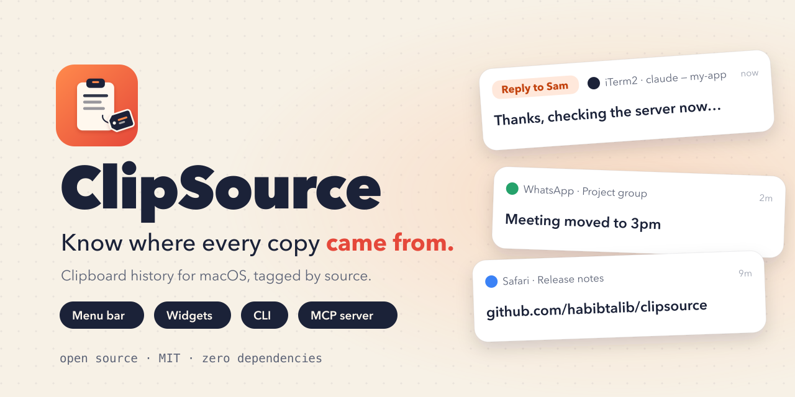
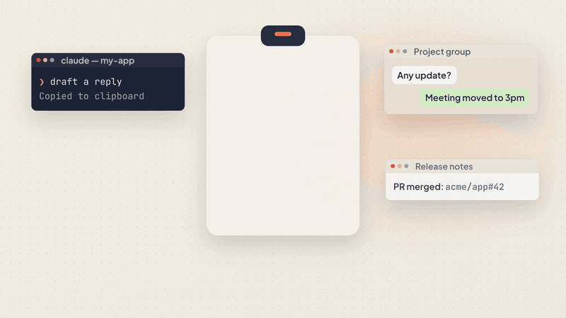
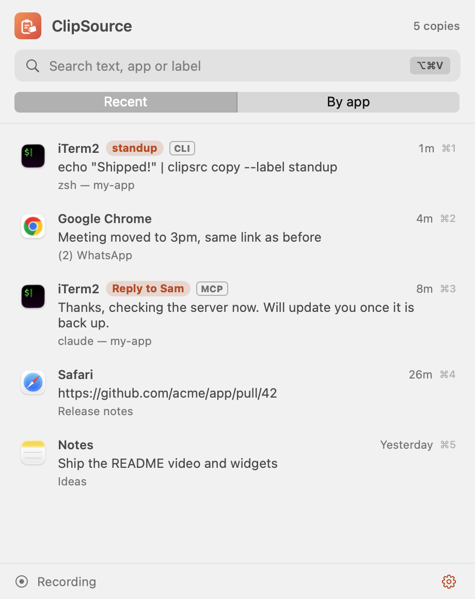
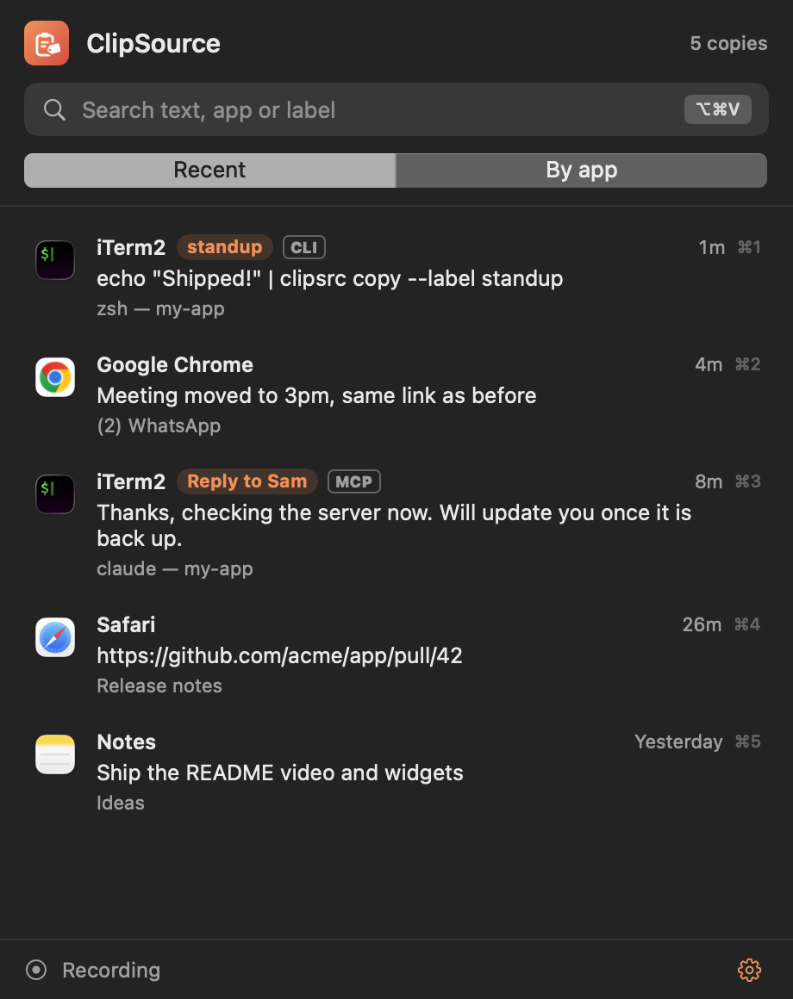
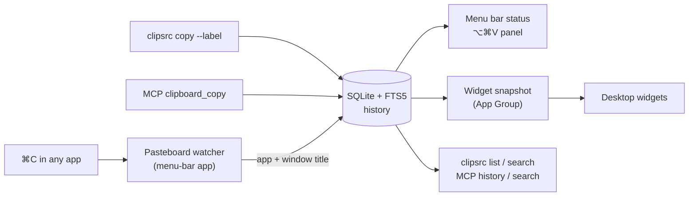
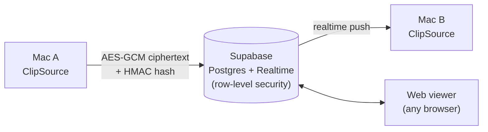

<p align="center">
  
</p>

<p align="center">
  <a href="https://github.com/habibtalib/clipsource/actions/workflows/ci.yml"></a>
  
  
  
  
  <a href="LICENSE"></a>
  <a href="https://github.com/habibtalib/clipsource/stargazers"></a>
</p>

<p align="center">
  <b>A macOS clipboard manager that remembers <i>where</i> every copy came from:</b><br>
  the app, the window or chat, and the AI session that copied it.
</p>

<p align="center">
  <a href="#-install">Install</a> ·
  <a href="#-features">Features</a> ·
  <a href="#-desktop-widgets">Widgets</a> ·
  <a href="#-sync-across-devices">Sync</a> ·
  <a href="#-cli">CLI</a> ·
  <a href="#-mcp-server">MCP</a> ·
  <a href="#-privacy">Privacy</a>
</p>

---

## 🎬 See it in action

<p align="center">
  <a href="docs/assets/clipsource-demo.mp4">
    
  </a>
  <br>
  <sub>▶ <a href="docs/assets/clipsource-demo.mp4">Watch the MP4 with sound</a> (27 s)</sub>
</p>

<p align="center">
  
  &nbsp;
  
</p>

## 🤔 Why

Say you have three Claude Code sessions, a WhatsApp group, Slack and a browser all writing to one clipboard. You paste, and only then wonder which chat the text was for and which session wrote it.

**ClipSource puts a tag on every copy.** Each tag records the app, the window title (which shows the chat or terminal tab), and, for copies made by AI agents, a label, the session ID and the project folder. Search the history, see the latest source live in the menu bar, and copy any entry again with one click.

## ✨ Features

| | |
|---|---|
| 🏷️ **Source on every entry** | App, bundle ID, focused window or chat title, label, session ID, working directory, terminal |
| 📍 **Live menu-bar status** | The menu bar shows where the latest copy came from, such as `Reply to Sam` or `WhatsApp` |
| 🔁 **Hold ⌘V to choose** | Like ⌘Tab for the clipboard. Tap ⌘V to paste as usual; hold it and the switcher opens. Press V or ↓ to move down, ⇧V or ↑ to move up, 1–9 to jump, and release ⌘ to paste the selected entry. Esc cancels. |
| ✨ **Copy toast** | Each ⌘C shows a small animated card: a spinner while the source is looked up, then a check with the app, the Claude Code session or chat, and the repo and branch. |
| 🧭 **Session and repo** | Copies from a terminal whose title is a Claude Code session are linked to that session (from its transcript), its folder and its git repo and branch. CLI and MCP copies get the same through their session ID. |
| ⌨️ **⌥⌘V panel** | Floating search over the whole history, *Recent* or *By app*. Keyboard: ↑↓, Return to copy, ⌘1–9 for the top entries, Esc to close. |
| 🧩 **Desktop widgets** | *Latest Copy* and *Recent Copies*, updated on every clipboard change. Click a row to copy it again. |
| 🖥️ **`clipsrc` CLI** | A drop-in for `pbcopy` that adds a tag: `echo hi \| clipsrc copy --label "Sam reply"` |
| 🤖 **MCP server** | AI agents copy with a label and read or search the history, for example from Claude Code |
| ⌨️ **Chrome extension** | Types a history entry as real keystrokes into web consoles that ignore ⌘V, such as Guacamole and PAM portals like XTON. It types only on sites you've allowed. ⌥⇧V types the latest entry; ⌥⇧H opens the picker. |
| 🔄 **Cross-device sync** | Opt-in. Sign in with GitHub or Google and every Mac shares one history, plus a web page for any other device. End-to-end encrypted. |
| 🔒 **Private by default** | History stays local in SQLite unless you turn on sync. Password-manager copies and excluded apps are never stored. |
| 🪶 **Zero dependencies** | Swift, SwiftUI, AppKit, WidgetKit and the system SQLite (FTS5). That's all. |

## 🚀 Install

Requires **macOS 14 or later** and Xcode 15+ (or the Swift toolchain).

```bash
git clone https://github.com/habibtalib/clipsource.git
cd clipsource
Scripts/bundle-app.sh --install
open ~/Applications/ClipSource.app
```

This installs `ClipSource.app` in `~/Applications`, and `clipsrc` and `clipsource-mcp` in `~/.local/bin` (add that folder to your `PATH`).

<details>
<summary><b>With desktop widgets (signed build)</b></summary>

Widgets need a team-signed app that shares an App Group with the widget extension. A free Personal Team works; find your team ID in *Xcode → Settings → Accounts*.

```bash
brew install xcodegen
CLIPSOURCE_TEAM=<your team id> Scripts/build-widgets.sh --install
```

</details>

<details>
<summary><b>Permissions</b></summary>

- **Accessibility** (*System Settings → Privacy & Security → Accessibility*) lets ClipSource read window titles: chat names, terminal tabs and browser tabs. Without it, only the app name is recorded.
- The SwiftPM build is ad-hoc signed, so after each rebuild remove ClipSource from the Accessibility list and add it again.
- For the CLI and MCP server to record the terminal's window title too, give your terminal app (Terminal, iTerm2, …) Accessibility permission as well.

</details>

## 🧠 How it works



| Copy made by | What gets recorded |
|---|---|
| You (⌘C anywhere) | Frontmost app, bundle ID, focused window title. In a terminal, also the Claude Code session whose title matches the window, and its folder. |
| `clipsrc copy` | The above, plus `--label`, the current folder, `$TERM_PROGRAM` and the session ID |
| MCP `clipboard_copy` | Same as `clipsrc`. The folder is the agent's project directory. |

Sessions are found by reading the end of each Claude Code transcript (`~/.claude/projects/*/<session>.jsonl`, plus `$CLAUDE_CONFIG_DIR` and `~/.claude-profiles/*`), only for sessions active in the last 3 days. The transcripts are only read, never sent anywhere; the repo name and branch come from the folder's `.git`.

The hold-⌘V switcher uses a keyboard event tap, so it needs the same Accessibility permission as window titles. Turn it, or the copy toast, off in *Settings → Status*.

The session ID is taken from `$CLIPSOURCE_SESSION`, then `$CLAUDE_SESSION_ID`, then `$CLAUDE_CODE_SESSION_ID`. The CLI and MCP server write the entry before setting the clipboard, and the watcher skips content recorded in the last 3 s, so each copy is stored once with the fullest source.

## 🧩 Desktop widgets

| Widget | Sizes | Shows |
|---|---|---|
| **Latest Copy** | small, medium | The newest entry, its source and a live "copied … ago" |
| **Recent Copies** | medium, large | The last 3 or 6 entries by source. Click one to copy it again (`clipsource://restore/<id>`). |

Turn on *Settings → Hide clipboard text in widgets* to keep clipboard text off your desktop.

## ⌨️ Chrome extension: type into web consoles

Some browser-based consoles, such as Apache Guacamole and the PAM portals built on it, draw the remote screen on a canvas and ignore ⌘V. The ClipSource extension types a history entry into them instead, as real keystrokes.

- **⌥⇧H** opens the picker (search, ↑↓, Return), and **⌥⇧V** types the latest entry.
- Multi-line or long entries ask for confirmation first, because each line runs as a command. Stop at any time from the popup or with the shortcut.
- It types only on sites you've allowed. On Guacamole and XTON Access Manager pages it offers to turn itself on, and asks once per site. It stops at once if the tab navigates away, so a session that expires mid-way never receives the remaining lines.
- It works locally only: the extension reads history through `clipsrc` (Chrome native messaging) and sends keystrokes only to the tab you picked.

```bash
# chrome://extensions → Developer mode → Load unpacked → choose chrome-extension/
clipsrc native-host --install kbaaegkcchoinnblhajbhjljpkgbckom
```

Chrome shows "started debugging this browser" while it types; that is how it sends trusted keystrokes. See [chrome-extension/README.md](chrome-extension/README.md).

## 🔄 Sync across devices

**ClipSource Cloud** shares one history between your Macs, and lets you read or send entries from any other device (Windows, Linux, phone) on the web app. Turn it on in *Settings → Sync*. There's nothing to configure: you just sign in.

| | Free | Pro |
|---|---|---|
| Macs | 2 | Unlimited |
| Web app | ✓ (doesn't count as a device) | ✓ |
| Synced history | 7 days | 1 year |
| End-to-end encryption | ✓ | ✓ |
| Price | $0 | $3/month or $24/year |

The Mac app, local history, the CLI, the MCP server and the Chrome extension stay free and open source. Plans cover only the hosted sync.



1. **Sign in** with GitHub or Google (OAuth with PKCE, in the system browser sheet).
2. **Set a sync passphrase** on the first Mac and enter the same one on the others. It never leaves your devices and can't be recovered.
3. Copies appear on your other devices within a second or two, with the source tag and a chip showing which device made them.
4. Manage your plan and devices in *Settings → Sync* or at <https://clipsource.app/account>.

- **End-to-end encrypted.** The passphrase goes through PBKDF2-SHA256 (600,000 rounds) to a key that stays in your Keychain. Every entry, including its text, app, window and label, is sealed with AES-GCM before upload. The server stores only ciphertext, an HMAC used to merge duplicates, timestamps and a random ID for the device that wrote the row. Your device list (names and type) is account metadata, so the account page can show it.
- **Nothing is copied to your clipboard behind your back.** Entries from other devices land in history. Turn on *Copy entries from other devices to this Mac's clipboard* if you want Universal-Clipboard-style behaviour.
- **Deletes sync too.** Deleting or clearing on one device removes the entries everywhere. *Delete my synced data* wipes the server copy.
- **Web app:** <https://clipsource.app/app>. Sign in, enter the passphrase, then click an entry to copy it, or use *Send to my Macs*. Decryption happens in the browser.
- **Or run your own.** Under *Settings → Sync → Advanced*, point ClipSource at your own Supabase project, either the free tier or self-hosted. [supabase/README.md](supabase/README.md) has the schema, the edge functions and the setup.

<details>
<summary><b>Sync from the command line</b></summary>

```bash
clipsrc sync status                 # server, account, locked or unlocked, pending count
clipsrc sync account                # plan, synced-history length, devices
clipsrc sync once                   # push and pull now
clipsrc sync setup --url https://<ref>.supabase.co --anon-key <key>
clipsrc sync unlock < passphrase.txt
```

The app keeps syncing in the background. These commands are for scripts and self-hosted setups.

</details>

## 💻 CLI

```bash
echo "Draft reply" | clipsrc copy --label "Sam reply"   # copy and tag
clipsrc list --limit 10                                   # recent entries
clipsrc list --app WhatsApp --since 2h --json             # filter, JSON output
clipsrc search invoice                                    # full-text search
clipsrc get 42                                            # full text and source
clipsrc restore 42                                        # copy entry 42 back to the clipboard
```

## 🤖 MCP server

```bash
claude mcp add clipsource -s user -- ~/.local/bin/clipsource-mcp
```

| Tool | Arguments | Does |
|---|---|---|
| `clipboard_copy` | `text`, `label?` | Sets the clipboard and records the source |
| `clipboard_history` | `limit?`, `app?`, `label?`, `since?` | Lists recent entries with source and preview |
| `clipboard_search` | `query`, `limit?` | Full-text search over text, labels, windows and apps |
| `clipboard_get` | `id` | Returns the full text and source details |
| `clipboard_restore` | `id` | Puts an older entry back on the clipboard |

> **Tip:** tell your agent *"copy drafts with `clipboard_copy` and label them with the chat they're for"*. Every draft then shows up in the menu bar and widgets with its destination.

## 🔒 Privacy

- 🏠 **Local unless you turn on sync.** History lives in `~/Library/Application Support/ClipSource/history.sqlite` (override with `$CLIPSOURCE_DB`). With sync off, nothing is sent over the network.
- 🔐 **Synced entries are end-to-end encrypted.** The server sees only ciphertext, an HMAC per entry, timestamps, a random device ID and your device list.
- 🙈 **Never stored:** contents marked `org.nspasteboard.ConcealedType`, `TransientType` or `AutoGeneratedType` by password managers, and copies from excluded apps (1Password, Keychain Access, Passwords and Bitwarden by default).
- ⏸️ **Pause** recording from the menu.
- 🧹 **Retention:** 30 days or 5,000 entries by default, text only, up to 1 MB per entry.
- 🧩 **Widgets** read only a small snapshot of the last 6 entries, with 160-character previews.

## 🛠️ Development

```bash
swift build && swift test        # library, app, CLI, MCP server, and unit tests
node site/app/crypto.test.mjs    # web viewer crypto matches the Swift test vector
Scripts/sync-e2e.sh              # two simulated Macs against a local Supabase (Docker)
swift run ClipSource             # run the menu-bar app unbundled
```

```
Sources/ClipCore         Store (SQLite + FTS5), watcher, source resolver, privacy, widget snapshot
Sources/ClipSourceApp    SwiftUI menu-bar app, ⌥⌘V panel, settings
Sources/clipsrc          CLI
Sources/clipsource-mcp   MCP server (stdio JSON-RPC)
Sources/ClipCore/Sync    E2E crypto, Supabase client, realtime, sync engine
Widget/                  WidgetKit extension
site/                    Website, account page and web viewer (static, Vercel)
supabase/                Database schema, row-level security, setup guide
project.yml, Xcode/      XcodeGen spec, plists, entitlements, app icon (signed build)
docs/assets/             Logo, banner and demo video
```

Contributions are welcome. See [CONTRIBUTING.md](CONTRIBUTING.md).

## 📄 License

[MIT](LICENSE) © Habib Talib

<p align="center">
  <br>
  <sub>If ClipSource saves you a wrong paste, consider giving it a ⭐</sub>
</p>
