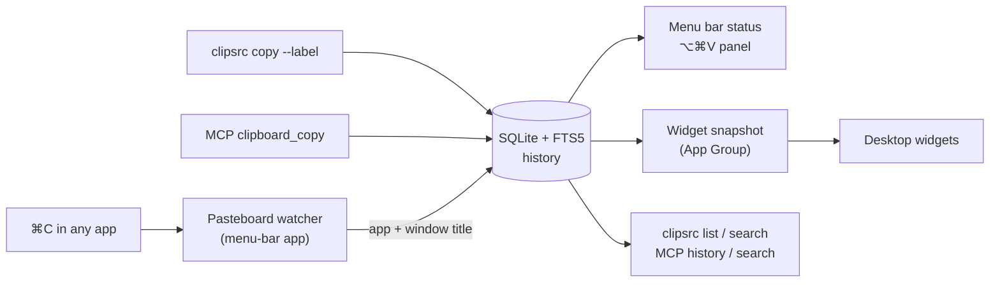

<p align="center">
  
</p>

<p align="center">
  <a href="https://github.com/habibtalib/clipsource/actions/workflows/ci.yml"></a>
  
  
  
  
  <a href="LICENSE"></a>
  <a href="https://github.com/habibtalib/clipsource/stargazers"></a>
</p>

<p align="center">
  <b>A macOS clipboard manager that remembers <i>where</i> every copy came from:</b><br>
  the app, the window or chat, and the AI session that copied it.
</p>

<p align="center">
  <a href="#-install">Install</a> ·
  <a href="#-features">Features</a> ·
  <a href="#-desktop-widgets">Widgets</a> ·
  <a href="#-cli">CLI</a> ·
  <a href="#-mcp-server">MCP</a> ·
  <a href="#-privacy">Privacy</a>
</p>

---

## 🎬 See it in action

<p align="center">
  <a href="docs/assets/clipsource-demo.mp4">
    
  </a>
  <br>
  <sub>▶ <a href="docs/assets/clipsource-demo.mp4">Watch the MP4 with sound</a> (27 s)</sub>
</p>

<p align="center">
  
  &nbsp;
  
</p>

## 🤔 Why

Say you have three Claude Code sessions, a WhatsApp group, Slack and a browser all writing to one clipboard. You paste, and only then wonder which chat the text was for and which session wrote it.

**ClipSource puts a tag on every copy.** Each tag records the app, the window title (which shows the chat or terminal tab), and, for copies made by AI agents, a label, the session ID and the project folder. Search the history, see the latest source live in the menu bar, and copy any entry again with one click.

## ✨ Features

| | |
|---|---|
| 🏷️ **Source on every entry** | App, bundle ID, focused window or chat title, label, session ID, working directory, terminal |
| 📍 **Live menu-bar status** | The menu bar shows where the latest copy came from, such as `Reply to Sam` or `WhatsApp` |
| ⌨️ **⌥⌘V panel** | Floating search over the whole history, *Recent* or *By app*. Keyboard: ↑↓, Return to copy, ⌘1–9 for the top entries, Esc to close. |
| 🧩 **Desktop widgets** | *Latest Copy* and *Recent Copies*, updated on every clipboard change. Click a row to copy it again. |
| 🖥️ **`clipsrc` CLI** | A drop-in for `pbcopy` that adds a tag: `echo hi \| clipsrc copy --label "Sam reply"` |
| 🤖 **MCP server** | AI agents copy with a label and read or search the history, for example from Claude Code |
| 🔒 **Private by default** | History stays local in SQLite. Password-manager copies and excluded apps are never stored. |
| 🪶 **Zero dependencies** | Swift, SwiftUI, AppKit, WidgetKit and the system SQLite (FTS5). That's all. |

## 🚀 Install

Requires **macOS 14 or later** and Xcode 15+ (or the Swift toolchain).

```bash
git clone https://github.com/habibtalib/clipsource.git
cd clipsource
Scripts/bundle-app.sh --install
open ~/Applications/ClipSource.app
```

This installs `ClipSource.app` in `~/Applications`, and `clipsrc` and `clipsource-mcp` in `~/.local/bin` (add that folder to your `PATH`).

<details>
<summary><b>With desktop widgets (signed build)</b></summary>

Widgets need a team-signed app that shares an App Group with the widget extension. A free Personal Team works; find your team ID in *Xcode → Settings → Accounts*.

```bash
brew install xcodegen
CLIPSOURCE_TEAM=<your team id> Scripts/build-widgets.sh --install
```

</details>

<details>
<summary><b>Permissions</b></summary>

- **Accessibility** (*System Settings → Privacy & Security → Accessibility*) lets ClipSource read window titles: chat names, terminal tabs and browser tabs. Without it, only the app name is recorded.
- The SwiftPM build is ad-hoc signed, so after each rebuild remove ClipSource from the Accessibility list and add it again.
- For the CLI and MCP server to record the terminal's window title too, give your terminal app (Terminal, iTerm2, …) Accessibility permission as well.

</details>

## 🧠 How it works



| Copy made by | What gets recorded |
|---|---|
| You (⌘C anywhere) | Frontmost app, bundle ID, focused window title |
| `clipsrc copy` | The above, plus `--label`, the current folder, `$TERM_PROGRAM` and the session ID |
| MCP `clipboard_copy` | Same as `clipsrc`. The folder is the agent's project directory. |

The session ID is taken from `$CLIPSOURCE_SESSION`, then `$CLAUDE_SESSION_ID`, then `$CLAUDE_CODE_SESSION_ID`. The CLI and MCP server write the entry before setting the clipboard, and the watcher skips content recorded in the last 3 s, so each copy is stored once with the fullest source.

## 🧩 Desktop widgets

| Widget | Sizes | Shows |
|---|---|---|
| **Latest Copy** | small, medium | The newest entry, its source and a live "copied … ago" |
| **Recent Copies** | medium, large | The last 3 or 6 entries by source. Click one to copy it again (`clipsource://restore/<id>`). |

Turn on *Settings → Hide clipboard text in widgets* to keep clipboard text off your desktop.

## 💻 CLI

```bash
echo "Draft reply" | clipsrc copy --label "Sam reply"   # copy and tag
clipsrc list --limit 10                                   # recent entries
clipsrc list --app WhatsApp --since 2h --json             # filter, JSON output
clipsrc search invoice                                    # full-text search
clipsrc get 42                                            # full text and source
clipsrc restore 42                                        # copy entry 42 back to the clipboard
```

## 🤖 MCP server

```bash
claude mcp add clipsource -s user -- ~/.local/bin/clipsource-mcp
```

| Tool | Arguments | Does |
|---|---|---|
| `clipboard_copy` | `text`, `label?` | Sets the clipboard and records the source |
| `clipboard_history` | `limit?`, `app?`, `label?`, `since?` | Lists recent entries with source and preview |
| `clipboard_search` | `query`, `limit?` | Full-text search over text, labels, windows and apps |
| `clipboard_get` | `id` | Returns the full text and source details |
| `clipboard_restore` | `id` | Puts an older entry back on the clipboard |

> **Tip:** tell your agent *"copy drafts with `clipboard_copy` and label them with the chat they're for"*. Every draft then shows up in the menu bar and widgets with its destination.

## 🔒 Privacy

- 🏠 **Local only.** History lives in `~/Library/Application Support/ClipSource/history.sqlite` (override with `$CLIPSOURCE_DB`). Nothing is sent over the network.
- 🙈 **Never stored:** contents marked `org.nspasteboard.ConcealedType`, `TransientType` or `AutoGeneratedType` by password managers, and copies from excluded apps (1Password, Keychain Access, Passwords and Bitwarden by default).
- ⏸️ **Pause** recording from the menu.
- 🧹 **Retention:** 30 days or 5,000 entries by default, text only, up to 1 MB per entry.
- 🧩 **Widgets** read only a small snapshot of the last 6 entries, with 160-character previews.

## 🛠️ Development

```bash
swift build && swift test        # library, app, CLI, MCP server, and 13 unit tests
swift run ClipSource             # run the menu-bar app unbundled
```

```
Sources/ClipCore         Store (SQLite + FTS5), watcher, source resolver, privacy, widget snapshot
Sources/ClipSourceApp    SwiftUI menu-bar app, ⌥⌘V panel, settings
Sources/clipsrc          CLI
Sources/clipsource-mcp   MCP server (stdio JSON-RPC)
Widget/                  WidgetKit extension
project.yml, Xcode/      XcodeGen spec, plists, entitlements, app icon (signed build)
docs/assets/             Logo, banner and demo video
```

Contributions are welcome. See [CONTRIBUTING.md](CONTRIBUTING.md).

## 📄 License

[MIT](LICENSE) © Habib Talib

<p align="center">
  <br>
  <sub>If ClipSource saves you a wrong paste, consider giving it a ⭐</sub>
</p>
